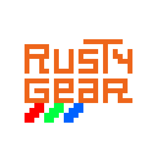

# RustyGear

**RustyGear** is a simple SEGA Game Gear emulator written in rust

**It is very much still a WIP, so do not expect perfection**

### How to use

Download one of the executables from the releases for your platform

Provide your own BIOS and ROM files through the dropdown

File -> Load BIOS

File -> Open ROM

Then you should be all set to play, you can change your key binds in the dropdown

Options -> Input Bindings